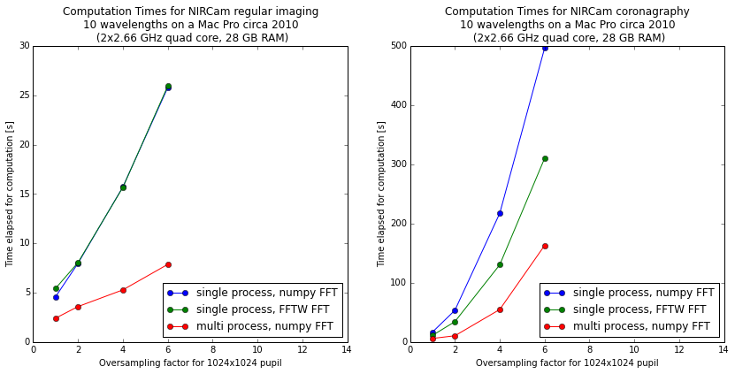

.. _performance_and_parallelization:

Appendix A: Array Backends, Performance, and Parallelization
=============================================================

Performance optimization on modern machines is a complex subject. This page describes the main choices
that affect how fast POPPY runs: which array library does the math (the *array backend*), which accelerated
libraries are used for transforms, and how calculations are parallelized.

.. note::

   TL, DR: For most users on a CPU, the default numpy backend is the right choice. Make sure your numpy is linked against an
   optimized linear algebra library (this is usually the case for Conda installs), and consider installing
   `numexpr <https://github.com/pydata/numexpr>`_ plus either `pyFFTW <https://pyfftw.readthedocs.io>`_ or, on Intel CPUs,
   `mkl_fft <https://anaconda.org/intel/mkl_fft>`_.
   If you have an NVIDIA GPU, select the ``cupy`` array backend for speedups of 10x to 80x on large calculations
   (see :ref:`gpu_acceleration`).

.. _array_backends:

Array Backends
--------------

All of POPPY's array math is written against the `Python array API standard <https://data-apis.org/array-api/latest/>`_,
using `array-api-compat <https://data-apis.org/array-api-compat/>`_ to provide a consistent interface to the underlying
array library. This means the same POPPY code can run on different array libraries. The library in use is called the
*array backend*.

======================= ===========================================================================================
Backend                 Status
======================= ===========================================================================================
``numpy``               Default. Runs on the CPU, with optional FFTW, MKL and numexpr accelerators (see below).
``cupy``                Runs on NVIDIA GPUs. Requires CuPy and a CUDA GPU. See :ref:`gpu_acceleration`.
``jax``                 Not yet supported. Planned as a future addition now that POPPY follows the array API.
======================= ===========================================================================================

**Selecting a backend.** The backend is chosen once, when ``poppy`` is first imported, from the ``array_backend``
setting in the POPPY configuration file (see :ref:`configuration`)::

   [poppy]
   array_backend = cupy

Valid values are ``numpy``, ``cupy``, and ``auto`` (the default), which uses CuPy if the ``use_cupy`` setting is true and a
GPU is available, and numpy otherwise. Requesting ``cupy`` explicitly raises an error if CuPy or a GPU is not available.

Because the backend is fixed at import time, it is **not possible to switch backends within a Python session**. Changing
``poppy.conf.array_backend`` after importing poppy has no effect other than logging a warning.

**Where the data lives.** Wavefront arrays, the arrays returned by optical elements (for instance ``get_opd`` and
``get_transmission``), and all intermediate calculations are arrays from the selected backend. For example, with the ``cupy`` backend
they stay in GPU memory throughout a propagation, avoiding transfers between the GPU and the host.
Results that are meant for output or display are converted to ordinary numpy arrays on the host: the PSFs returned by
``calc_psf`` are FITS ``HDUList`` objects, plots are made from numpy data, and arrays you pass in (lists, numpy arrays,
FITS data) are converted to the backend's array type when optical elements are created. If you need a
host copy of a backend array in your own code, use :py:func:`poppy.accel_math.to_numpy`.

**Precision.** Arrays are double precision (``float64``/``complex128``) by default. Set ``double_precision = False`` in the
configuration to use single precision (``float32``/``complex64``), which is faster and uses half the memory, at the cost of accuracy.

**scipy and the array API.** A few POPPY operations (resampling, rotating, and shifting arrays, Bessel functions, convolution)
use functions from scipy. These work with all backends, but in a way that depends on your configuration:

 * With the numpy backend, POPPY calls scipy directly, with no overhead.
 * With another backend, POPPY first uses the backend's own scipy equivalent where one exists (e.g. ``cupyx.scipy``).
 * If you have enabled scipy's own array API support by setting the environment variable ``SCIPY_ARRAY_API=1`` *before*
   importing scipy, POPPY will use scipy's native dispatch for these functions when it supports the backend.
 * Otherwise, the operation is performed on the host and the result copied back. This is correct but slower for GPU arrays, because of the data transfers.

POPPY never sets ``SCIPY_ARRAY_API`` itself, since it is a global setting that affects all code using scipy.

**Optional accelerators for the numpy backend.** The FFTW (via pyFFTW), Intel MKL (via mkl_fft), and numexpr libraries accelerate
the numpy backend only. They are controlled by the ``use_fftw``, ``use_mkl``, and ``use_numexpr`` settings, and
are used automatically if installed. They are disabled automatically when the ``cupy`` backend is in use.

**Multiprocessing is not supported with non-numpy backends.** Device contexts such as CUDA do not survive forking worker processes,
and a GPU already provides parallelism within each calculation. Requesting multiprocessing (see below) with a non-numpy
backend raises a ``NotImplementedError``; set ``poppy.conf.use_multiprocessing = False``.

Know your Linear Algebra Library
------------------------------------

The optical propagation calculations in POPPY are dominated by numerical implementations of:
 * Fourier transforms, either as Fast Fourier Transforms (mostly in Fresnel propagation) or as Matrix Fourier Transforms (mostly in Fraunhofer propagation)
 * a small number of matrix algebra calls, primarily matrix multiplication (used for the Matrix Fourier Transforms).
 * Miscellaneous array operations, such as rasterizing optical shapes such as circular apertures into discrete arrays.

This section applies to the numpy backend. Whether or not ``numpy`` is linked against an optimized
linear algebra library can make a **huge** difference in execution speed, with
speedups of an **order of magnitude or more**. You definitely want to make sure
that your numpy is using such a library. This is generally the case if you install
your Python setup via Conda, or from the standard pip wheels (which include OpenBLAS).

As of 2021, Intel's Math Kernel Library (MKL) provides the best performance for
both linear algebra and FFTs, on Intel CPUs. Installing an Intel MKL build of numpy
and the MKL FFT library are highly recommended on such machines.  If MKL is not available for your system, OpenBLAS
is also highly performant usually.

Optimal numerical implementations have changed over time. These recommendations may be out of date.
We recommend benchmarking tests on your own system for the utmost in performance.

 * Apple's `Accelerate framework
   <https://developer.apple.com/library/mac/documentation/Accelerate/Reference/AccelerateFWRef/index.html>`_
   (a.k.a. vecLib) provides a highly tuned copy of BLAS and LAPACK on any Mac,
   right out of the box.
 * `OpenBLAS <http://www.openblas.net>`_  is recommended on Linux.
 * `Intel MKL <https://www.intel.com/content/www/us/en/developer/tools/oneapi/onemkl.html>`_ is available for Intel CPUs
   through Conda and other distributions.

Parallelized Calculations
-------------------------

POPPY can parallelize calculations in several different ways:

  1. Relying on multithreaded implementations of low-level functions in numpy to thread
     individual array operations across multiple cores.  This also includes the use
     of FFT libraries (FFTW, MKL FFT) that multithread.
  2. Using a GPU (the ``cupy`` array backend; see :ref:`array_backends`) to run each array operation in parallel on the GPU.
  3. Using Python's ``multiprocessing`` package to launch many additional Python
     processes, each of which calculates a different wavelength. This is only supported
     with the numpy backend.

It used to be the case that multiple processes were recommended for more performance; however, as
numerical libraries have matured the added complexity (and startup overhead) of multi-process
calculations is not beneficial in most cases.

**For most users, the recommended choice is running single-process calculations and relying on numpy and MKL or FFTW to multithread calculations, or on a GPU.** This is the default behavior.

Using multiprocessing
^^^^^^^^^^^^^^^^^^^^^^

Most users should not need this; but we document these options for flexibility. Multiprocessing is only
available with the numpy backend; with other backends (for example ``cupy``), requesting it raises a ``NotImplementedError``.

The configuration options to enable multiprocessing live under :py:obj:`poppy.conf`, and use the Astropy configuration framework. Enable them as follows::

   >>> import poppy
   >>> poppy.conf.use_multiprocessing = True
   >>> poppy.conf.use_fftw = False

One caveat with running multiple processes is that the memory demands can become substantial for large oversampling factors.  For instance, a 1024-pixel-across pupil with ``oversampling=4`` results in arrays that are 256 MB each. Several such arrays are needed in memory per calculation, with peak memory utilization reaching ~ 1 GB per process for ``oversampling=4`` and over 4 GB per process for ``oversampling=8``.

Thus, if running on a 16-core computer, ensure at least 32 GB of RAM are available before using one process per core. If you are constrained by the amount of RAM available, you may experience better performance using fewer processes than the number of processor cores in your computer.

By default, POPPY attempts to automatically choose a number of processes based on available CPUs and free memory that will optimize computation speed without exhausting available RAM. This is implemented in the function :py:func:`poppy.utils.estimate_optimal_nprocesses`.

If desired, the number of processes can be explicitly specified::

  >>> poppy.conf.n_processes = 5

Set this to zero to enable automatic selection via the :py:func:`~poppy.utils.estimate_optimal_nprocesses` function.

Comparison of Different Parallelization Methods
^^^^^^^^^^^^^^^^^^^^^^^^^^^^^^^^^^^^^^^^^^^^^^^^

*This section is outdated; the following benchmark is from 2015.*

The following figure shows the comparison of single-process, single-process with FFTW, and multi-process calculations on a relatively high end 16-core Mac Pro. The calculations were done with WebbPSF, a PSF simulator for JWST that uses POPPY to perform computations.

The horizontal axis shows increasing detail of calculation via higher oversampling, while the vertical axis shows computation time. Note the very different
Y-axis scales for the two figures; coronagraphic calculations take much longer than direct imaging!

Using multiple Python processes is the clear winner for most workloads. Explore the options to find what works best for your particular calculations and computer setup.

Fourier Transform Benchmarks with Different Accelerated Math Libraries
------------------------------------------------------------------------

There are benchmarking functions in :py:mod:`poppy.accel_math` for measuring transform speed on your own machine,
comparing the numpy, FFTW, MKL, and numexpr options where installed: :py:func:`~poppy.accel_math.benchmark_fft`
for a single FFT size, :py:func:`~poppy.accel_math.benchmark_2d_ffts` for FFT runtime versus array size, and
:py:func:`~poppy.accel_math.benchmark_2d_mfts` for the same with Matrix Fourier Transforms. Results depend strongly on
your CPU, array sizes, and installed libraries, so we recommend running these before choosing settings for large calculations.

